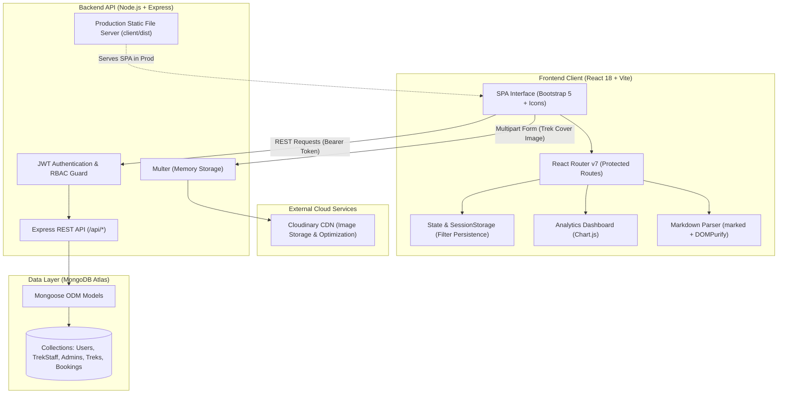
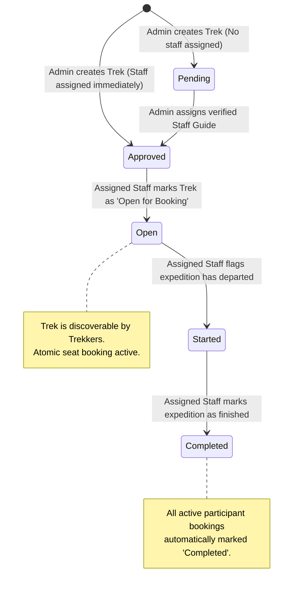

# 🏔️ TrekMate — Full-Stack Trekking Management System

[](https://nodejs.org/)
[](https://react.dev/)
[](https://vitejs.dev/)
[](https://expressjs.com/)
[](https://www.mongodb.com/)
[](https://cloudinary.com/)
[](https://getbootstrap.com/)

An enterprise-grade, role-based trekking expedition management platform built on the **MERN (MongoDB, Express, React, Node.js)** stack. Designed to streamline outdoor adventure logistics, TrekMate provides dedicated interfaces for **System Administrators**, **Expedition Staff Guides**, and **Trekkers**, featuring real-time seat inventory reservation, interactive Markdown trail itineraries, Cloudinary-backed media pipelines, and dynamic analytics.

---

## 📌 Table of Contents

- [System Architecture](#-system-architecture)
- [Trek Lifecycle & Workflow](#-trek-lifecycle--workflow)
- [Role-Based Access Control (RBAC)](#-role-based-access-control-rbac)
- [Key Engineering Highlights](#-key-engineering-highlights)
- [Technology Stack](#-technology-stack)
- [Local Setup & Installation](#-local-setup--installation)
- [Default System Credentials](#-default-system-credentials)
- [Production Deployment (Render.com)](#-production-deployment-rendercom)
- [API Reference](#-api-reference)

---

## 🏗️ System Architecture

TrekMate utilizes a decoupled client-server architecture with unified production static serving, centralized authentication via JWT, cloud asset management via Cloudinary, and document persistence with MongoDB Atlas.



---

## 🔄 Trek Lifecycle & Workflow

Treks undergo a controlled, role-enforced state machine ensuring proper vetting, staff assignment, seat reservation, and expedition completion:



---

## 🔐 Role-Based Access Control (RBAC)

| Feature / Permission | Administrator (`Admin`) | Expedition Staff (`Staff`) | Trekker (`User`) |
| :--- | :---: | :---: | :---: |
| **KPI & Booking Distribution Analytics** | ✅ Full Access | ❌ | ❌ |
| **Create & Update Treks** | ✅ Full Access | ❌ | ❌ |
| **Upload Trek Cover Images to Cloudinary** | ✅ | ❌ | ❌ |
| **Assign Guides to Treks** | ✅ | ❌ | ❌ |
| **User Management & Blacklisting** | ✅ | ❌ | ❌ |
| **Approve / Reject / Blacklist Staff** | ✅ | ❌ | ❌ |
| **Manage Assigned Trek Status** (`Open`, `Started`, `Completed`) | ❌ | ✅ (Assigned only) | ❌ |
| **View Expedition Participant Rosters** | ✅ (All) | ✅ (Assigned only) | ❌ |
| **Browse, Search & Filter Treks** | ✅ | ✅ | ✅ |
| **Atomic Seat Booking & Cancellation** | ❌ | ❌ | ✅ |
| **Manage Personal Bookings & Profile** | ❌ | ❌ | ✅ |

---

## 💡 Key Engineering Highlights

### 1. Atomic Booking & Concurrency Protection
To prevent overbooking when multiple users reserve the final available slot simultaneously, the reservation uses MongoDB's atomic `findOneAndUpdate` with conditional checks:
```javascript
const updated = await Trek.findOneAndUpdate(
  { _id: trekId, status: 'Open', availableSlots: { $gt: 0 } },
  { $inc: { availableSlots: -1 } },
  { new: true }
);
if (!updated) return res.status(409).json({ message: 'Trek is fully booked.' });
```
If booking creation fails downstream, an automated rollback restores the slot atomically.

### 2. Session-Persisted Trail Discovery Filters
Trekkers exploring itineraries often inspect full-page trek details before returning to the catalog. Search queries, difficulty ratings, timespans, regions, start dates, and sort orders are persisted into `sessionStorage`. Filters remain active across navigation and back actions, clearing only upon explicit user reset or tab closure.

### 3. Cloudinary Asset Pipeline & Fallbacks
- Direct in-memory buffer streaming through `multer` and `cloudinary.uploader.upload_stream` to the `trekmate/treks` cloud folder.
- Fallback resolution to region-specific high-resolution imagery if no custom cover is uploaded.
- Automated migration tooling for legacy and seeded external assets to cloud storage.

### 4. Markdown-Powered Expedition Itineraries
Admins can document day-by-day itineraries using rich Markdown (`# Headings`, `- Lists`, `**Bold**`, `> Quotes`). Content is sanitized via `DOMPurify` to defend against XSS while delivering typography with responsive desktop and mobile formatting.

---

## 💻 Technology Stack

- **Backend**: Node.js, Express.js (v4), Mongoose (v8), JSON Web Tokens (`jsonwebtoken`), `bcryptjs`, `multer`, `cloudinary` SDK.
- **Frontend**: React 18, Vite 6, React Router DOM (v7), Bootstrap 5.3, Bootstrap Icons, Chart.js, `react-chartjs-2`, `marked`, `dompurify`.
- **Database & Cloud**: MongoDB Atlas, Cloudinary Media Cloud, Render.com Web Services.

---

## 🚀 Local Setup & Installation

### Prerequisites
- [Node.js](https://nodejs.org/) (v20.x or higher)
- [npm](https://www.npmjs.com/) (v10.x or higher)
- [MongoDB Atlas](https://www.mongodb.com/cloud/atlas) cluster connection string or local MongoDB instance

### 1. Clone the Repository
```bash
git clone https://github.com/YASHK-arch/TrekMate.git
cd TrekMate
```

### 2. Environment Configuration
Create a `.env` file in the `server` directory:
```bash
# Windows PowerShell
Copy-Item server/.env.example server/.env

# macOS / Linux
cp server/.env.example server/.env
```

Populate `server/.env` with your credentials:
```env
PORT=5000
MONGODB_URI=mongodb+srv://<username>:<password>@cluster.mongodb.net/trekking_management?retryWrites=true&w=majority
JWT_SECRET=your_super_secret_jwt_key
CLIENT_ORIGIN=http://localhost:5173

# Cloudinary Storage
CLOUDINARY_CLOUD_NAME=your_cloud_name
CLOUDINARY_API_KEY=your_api_key
CLOUDINARY_API_SECRET=your_api_secret
```

### 3. Install Dependencies
Install all workspace dependencies from the root directory:
```bash
npm install
```

### 4. Run the Development Servers
Start both the Express API and the Vite frontend simultaneously:
```bash
npm run dev
```

- **Frontend Application**: `http://localhost:5173`
- **Backend REST API**: `http://localhost:5000`
- **API Health Check**: `http://localhost:5000/api/health`

---

## 🔑 Default System Credentials

The application seeds a super-admin account on first database connection:

| Role | Email / Username | Password | Notes |
| :--- | :--- | :--- | :--- |
| **System Admin** | `admin@trek.com` | `admin123` | Full administrative control |
| **Sample Staff** | `carlos.mendez@outlook.com` | `RiverGuide!` | Assigned guide for Vietnam region |
| **Sample Staff** | `maria.santos@yahoo.com` | `TrekLeader2024!` | Assigned guide for Fansipan |
| **Sample Trekker** | *Register via UI* | *Choose password* | Instant activation upon registration |

*(Note: Change default administrative credentials prior to exposing the deployment publicly).*

---

## 🌐 Production Deployment (Render.com)

TrekMate is architected for unified single-service deployment on Render. Express serves both the backend `/api` routes and the static production build of the Vite React client (`client/dist`).

1. **Create Web Service** on [Render.com](https://render.com) connected to your GitHub repository.
2. Configure settings:
   - **Environment**: `Node`
   - **Build Command**: `npm run render-build`
   - **Start Command**: `npm start`
3. Configure Environment Variables in Render:
   - `NODE_ENV`: `production`
   - `MONGODB_URI`: *Your MongoDB Atlas connection URI*
   - `JWT_SECRET`: *A secure random string*
   - `CLOUDINARY_CLOUD_NAME`: *Your Cloudinary cloud name*
   - `CLOUDINARY_API_KEY`: *Your Cloudinary API key*
   - `CLOUDINARY_API_SECRET`: *Your Cloudinary API secret*

---

## 📡 API Reference

### Authentication (`/api/auth`)
- `POST /api/auth/register` — Register a new User or Staff account
- `POST /api/auth/login` — Authenticate credentials and receive signed JWT
- `GET /api/auth/me` — Retrieve current authenticated session identity
- `PATCH /api/profile` — Update display name, email, or password

### Expeditions & Treks (`/api/treks`)
- `GET /api/treks` — List treks (filterable by `status`, `difficulty`, `region`, `public=true`)
- `GET /api/treks/:id` — Retrieve comprehensive trek details and guide info
- `POST /api/treks` — Create trek with optional cover image upload *(Admin)*
- `PATCH /api/treks/:id` — Update trek details, capacity, or image *(Admin)*
- `DELETE /api/treks/:id` — Delete trek and associated booking records *(Admin)*

### Bookings (`/api/treks` & `/api/bookings`)
- `POST /api/treks/:id/book` — Atomic slot reservation and booking *(Trekker)*
- `GET /api/bookings/mine` — View personal booking history and status *(Trekker)*
- `POST /api/bookings/:id/cancel` — Cancel reservation & restock slot *(Trekker)*
- `GET /api/bookings/stats` — Popular treks & booking status breakdown *(Public)*

### Administration (`/api/admin`)
- `GET /api/admin/summary` — Analytics dashboard metrics and distribution counts
- `GET /api/admin/users` — Paginated user directory with search
- `PATCH /api/admin/users/:id/toggle-blacklist` — Suspend or reinstate user access
- `GET /api/admin/staff` — List staff accounts with approval statuses
- `PATCH /api/admin/staff/:id/status` — Approve, reject, or blacklist staff guides
- `GET /api/admin/bookings` — System-wide expedition booking ledger

### Staff Operations (`/api/staff`)
- `GET /api/staff/summary` — Assigned treks summary, active treks, and participant counts
- `GET /api/staff/treks/:id` — Assigned trek details and confirmed participant roster
- `PATCH /api/staff/treks/:id/status` — Transition expedition state (`Approved` ➔ `Open` ➔ `Started` ➔ `Completed`)

---

## 📄 License & Credits
Developed as an Academic Capstone Project. Open source under the [MIT License](LICENSE).
Trek photography assets sourced and licensed via [Wikimedia Commons](https://commons.wikimedia.org/) under Creative Commons.
